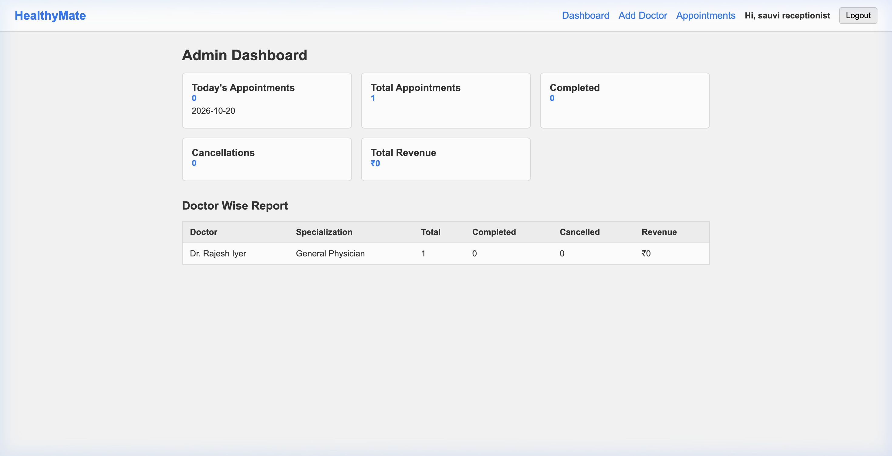
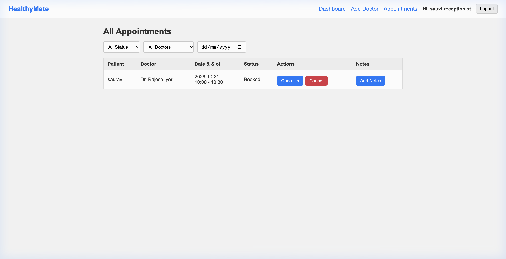
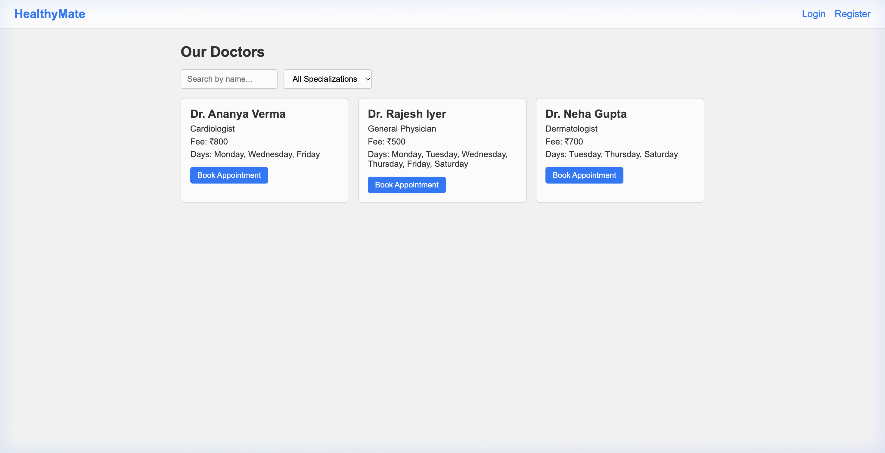
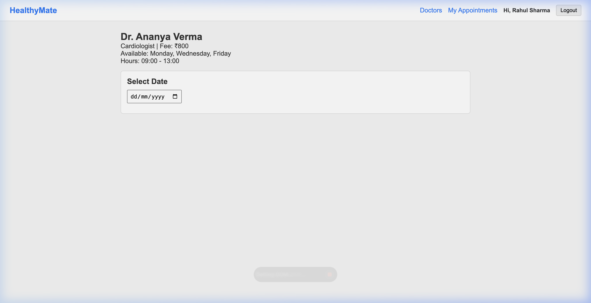
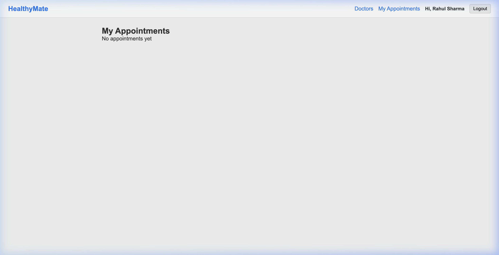

# HealthyMate - Clinic Appointment & Patient Visit System

This is my Assignment 6 MERN project based on Problem Statement 5 (PS5).
HealthyMate is a web app where patients can book doctor appointments in fixed time slots, and the clinic receptionist/admin can manage doctor schedules, check-in patients, update visit status, and write prescription notes.

---

## Screenshots

### 1. Receptionist / Admin Dashboard


### 2. Receptionist / Admin Appointments Management (Check-In & Notes)


### 3. Patient Doctors Directory & Search


### 4. Doctor Detail & Time Slot Booking


### 5. Patient My Appointments (History & Status)


---

## Features

### For Patients:
- Register and Login with role-based access
- View list of available doctors with specialization filter and search by name
- Check doctor details, available days, and consultation fees
- Pick a date and see generated time slots (booked slots are disabled to prevent double-booking)
- Book an appointment for a specific slot
- View booking history under "My Appointments"
- Cancel an appointment or reschedule it to another free slot

### For Admin / Receptionist (sauvi receptionist):
- Clinic Dashboard showing today's appointments, total bookings, completed visits, cancellations, and doctor-wise stats
- Add new doctors with available days, working hours, and slot duration
- Edit existing doctor details and schedules
- Manage all clinic appointments: update status (Booked -> Checked-In -> Completed / Cancelled)
- Add visit notes (diagnosis and prescription) for completed visits

---

## Tech Stack
- **Frontend**: React (Vite), React Router DOM, plain CSS
- **Backend**: Node.js, Express.js
- **Database**: MongoDB Atlas with Mongoose
- **Authentication**: JWT (JSON Web Tokens) and bcrypt password hashing

---

## Project Structure

```
assignment-6/
├── backend/
│   ├── middleware/
│   │   └── auth.js
│   ├── models/
│   │   ├── Appointment.js
│   │   ├── Doctor.js
│   │   └── User.js
│   ├── routes/
│   │   ├── admin.js
│   │   ├── appointments.js
│   │   ├── auth.js
│   │   └── doctors.js
│   ├── .env.example
│   ├── seed.js
│   └── server.js
├── frontend/
│   ├── src/
│   │   ├── components/
│   │   │   └── Navbar.jsx
│   │   ├── context/
│   │   │   └── AuthContext.jsx
│   │   ├── pages/
│   │   │   ├── AdminAppointments.jsx
│   │   │   ├── AdminDashboard.jsx
│   │   │   ├── AdminDoctorEdit.jsx
│   │   │   ├── AdminDoctorNew.jsx
│   │   │   ├── AppointmentDetail.jsx
│   │   │   ├── DoctorDetail.jsx
│   │   │   ├── Doctors.jsx
│   │   │   ├── Login.jsx
│   │   │   ├── MyAppointments.jsx
│   │   │   └── Register.jsx
│   │   ├── App.jsx
│   │   └── index.css
│   ├── vercel.json
│   └── index.html
└── screenshots/
    ├── admin_appointments.png
    ├── admin_dashboard.png
    ├── booking_page.png
    ├── doctors_list.png
    └── my_appointments.png
```

---

## How to Setup and Run Locally

### 1. Backend Setup
1. Open terminal and navigate to the backend folder:
   ```bash
   cd backend
   ```
2. Install dependencies:
   ```bash
   npm install
   ```
3. Create a `.env` file inside the `backend` folder and add your configuration (refer to `.env.example`):
   ```env
   PORT=5001
   MONGO_URI=your_mongodb_connection_string
   JWT_SECRET=your_jwt_secret_key
   ADMIN_NAME=sauvi receptionist
   ADMIN_EMAIL=your_admin_email
   ADMIN_PASSWORD=your_admin_password
   ADMIN_PHONE=your_admin_phone
   ```
4. Run the seed script to create initial sample doctors and demo accounts:
   ```bash
   node seed.js
   ```
5. Start the backend server:
   ```bash
   node server.js
   ```
   Backend will run on `http://localhost:5001`.

---

### 2. Frontend Setup
1. In a new terminal, navigate to the frontend folder:
   ```bash
   cd frontend
   ```
2. Install dependencies:
   ```bash
   npm install
   ```
3. Start the Vite development server:
   ```bash
   npm run dev
   ```
4. Open your browser at `http://localhost:5173`.

---

## API Endpoints

### Auth Routes (`/api/auth`)
- `POST /api/auth/register` - Register a new patient
- `POST /api/auth/login` - Login for patient and admin
- `GET /api/auth/me` - Get current logged-in user profile

### Doctor Routes (`/api/doctors`)
- `GET /api/doctors` - Get doctors (supports `?specialization=` and `?search=`)
- `GET /api/doctors/specializations` - Get unique specializations list
- `GET /api/doctors/:id` - Get details of a single doctor
- `GET /api/doctors/:id/slots?date=YYYY-MM-DD` - Generate time slots and availability for a date
- `POST /api/doctors` - Add a doctor (Admin only)
- `PUT /api/doctors/:id` - Update doctor details (Admin only)
- `DELETE /api/doctors/:id` - Delete a doctor (Admin only)

### Appointment Routes (`/api/appointments`)
- `POST /api/appointments` - Book an appointment slot
- `GET /api/appointments/my` - Get current user's appointments
- `GET /api/appointments/:id` - Get appointment details
- `PUT /api/appointments/:id/cancel` - Cancel appointment
- `PUT /api/appointments/:id/reschedule` - Reschedule appointment to another slot
- `PUT /api/appointments/:id/status` - Update status (Admin only)
- `PUT /api/appointments/:id/notes` - Add diagnosis and prescription notes (Admin only)

### Admin Routes (`/api/admin`)
- `GET /api/admin/dashboard` - Get clinic analytics and doctor stats
- `GET /api/admin/appointments` - View all appointments with filters

---

## Demo Test Logins

- **Admin / Receptionist**:
  - Email: `admin@clinic.com`
  - Password: `admin123`
  - Role: `admin`

- **Patient**:
  - Email: `patient@clinic.com`
  - Password: `patient123`
  - Role: `patient`
  *(Or register any new patient directly via the Register page)*
